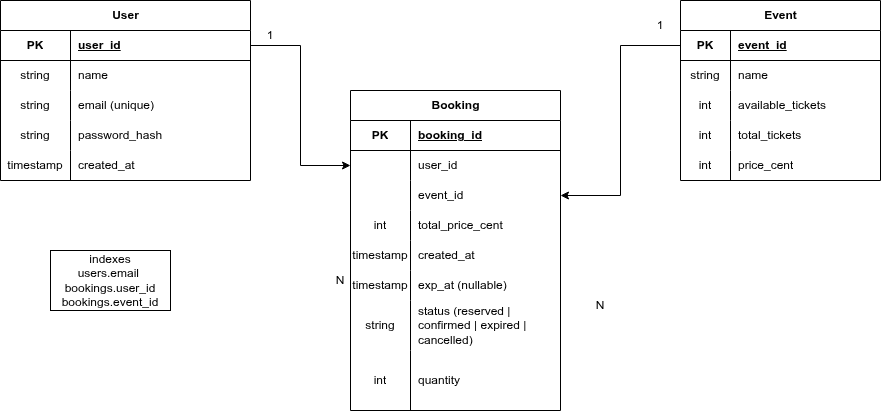

# Flash-Sale

A backend API for booking tickets to events, built to survive the moment when thousands of people hit "book" at the same time on a limited number of tickets.

> 🚧 Work in progress. I'm building this stage by stage and measuring every step.

## Why I'm building this

Selling 1,000 tickets to 10,000 people at once looks easy until two requests read "1 ticket left" at the same moment and both buy it. That's called overselling, and it's the problem this project is about.

I'm starting with a naive version on purpose, measuring how bad it gets, and then fixing it step by step with Redis, queues, and Docker. Every stage gets real numbers, so I can prove each change actually helped.

## Business Rules

1. **A booking can have 1 to 4 tickets.** Booking more than one ticket at a time forces the stock check and the decrease to happen as one atomic step, which is where the interesting problems start.
2. **A user can have one active booking per event.** Active means reserved or confirmed. This stops one person from grabbing all the stock, and it means the same request sent twice must not create two bookings.
3. **A reservation expires after 5 minutes.** If the user doesn't pay in time, the tickets go back to the available stock.
4. **Available tickets can never go below 0 or above the total.**

## Data Model



- **User**: who is booking.
- **Event**: what is being sold, with the total tickets, the available tickets, and the price.
- **Booking**: connects a user to an event, with the quantity, total price, status, and expiry time.

Booking status can be `reserved`, `confirmed`, `expired`, or `cancelled`. All prices are stored as integers in cents, never floats.

Field names in the code are camelCase (`availableTickets`, `priceCents`), while the diagram above uses snake_case.

Since stage 3, each event also has a Redis hash at `event:<id>` with `totalTickets`, `availableTickets` and `priceCents`. That hash is the live stock counter used for booking.

## API

| Method | Endpoint                  | Description                                            |
| ------ | ------------------------- | ------------------------------------------------------ |
| POST   | `/api/v1/events`          | Create an event (`name`, `totalTickets`, `priceCents`) |
| GET    | `/api/v1/events/:id`      | Get an event and its available tickets                 |
| POST   | `/api/v1/events/:id/book` | Book tickets (`userId`, `quantity` from 1 to 4)        |

All errors return a consistent JSON response (`status` and `message`).

## Tech Stack

Node.js, Express 5, MongoDB (Mongoose), Redis, BullMQ, Docker.

## Stages

| #   | Stage                                | Status      |
| --- | ------------------------------------ | ----------- |
| 1   | Naive booking + baseline numbers     | Done        |
| 2   | Atomic update in MongoDB             | Done        |
| 3   | Redis for stock (atomic Lua script)  | Done        |
| 3b  | Redis cache for GET /events/:id      | Next        |
| 4   | BullMQ queues and workers            | Not started |
| 5   | Reservations, events, mock payment   | Not started |
| 6   | Docker Compose, nginx, CI/CD, deploy | Not started |
| 7   | Tests, logging, final benchmarks     | Not started |

## Known limitations (current stage)

- There is no login yet. `userId` comes from the request body and isn't checked against a real user. Authentication comes in stage 5.
- If the server crashes between the atomic stock decrement in Redis and saving the booking in MongoDB, those tickets are lost. The code gives the tickets back when saving the booking fails, but it can't do that if the process dies. Queues (stage 4) and reservations (stage 5) address this.
- The stock counter now lives in Redis, so the `availableTickets` field in MongoDB is no longer updated after an event is created. `GET /api/v1/events/:id` still reads from MongoDB and shows a stale number. This is fixed in stage 3b.
- If Redis restarts, the counters can be lost or roll back to an older snapshot. Redis persistence (AOF) is not configured yet.
- If saving the event hash in Redis fails after the event is created in MongoDB, that event answers 404 on every booking.
- Business rules 1 and 4 are enforced. Rules 2 and 3 come in later stages.
- The same request sent twice creates two bookings (no idempotency yet).

## How I measure

- The API, MongoDB and Redis all run in Docker, and I keep the same setup in every stage so the numbers are comparable.
- The API runs with `npm start` and `NODE_ENV=production`, with no file watcher and no source code mounted into the container.
- Each benchmark starts with 1 warm-up run (ignored), and then 3 measured runs. Every run uses a fresh event with 1,000 tickets.
- Each result is the average of the 3 runs, plus the range (min to max). The runs are noisy, and autocannon reports req/sec in whole seconds, so small differences between stages may just be noise.
- "Errors" counts real failures only (connection errors, timeouts, 5xx). Requests rejected because the event is sold out are counted separately.
- My first attempt was wrong: I ran the API with nodemon and a source bind mount, and a deprecation warning was printed on every request. That distorted the numbers (stage 1 showed about 308 req/s). I fixed the setup and re-measured both stages. The old raw files are kept in `results/old-nodemon/`.
- From stage 3 on, the load test reads the final stock from Redis (where the counter lives) and the bookings from MongoDB. "Stock mismatch" compares the two: 0 means the Redis counter and the MongoDB bookings agree.

## Test Environment

- **Host Specs:** 8 CPU Cores, 8 GB RAM.
- **Docker Allocation:** Default Docker Desktop settings.
- **Node.js Environment:** `NODE_ENV=production` inside Docker, started with `npm start`.
- **Redis:** `redis:7-alpine`, one container, default config.
- **Load Test Tool:** `autocannon`
  - `amount`: 5,000 requests
  - `connections`: 200 concurrent connections
  - `excludeErrorStats`: false

## Results

Same test every time: 1,000 tickets, 5,000 requests sent over 200 concurrent connections, each request from a different user (`quantity: 1`).

| Stage               | Strategy                   | req/sec (avg, range)  | p99 latency (avg, range) | Errors | Rejected (sold out) | Bookings / Tickets | Oversold |
| ------------------- | -------------------------- | --------------------- | ------------------------ | ------ | ------------------- | ------------------ | -------- |
| **1. Naive**        | Read-then-write (Baseline) | 491 (417 - 556)       | 578 ms (435 - 791 ms)    | 0      | 0                   | 5,000 / 1,000      | +4,000   |
| **2. Mongo atomic** | Atomic update              | 608 (556 - 714)       | 615 ms (394 - 745 ms)    | 0      | 4,000               | 1,000 / 1,000      | 0        |
| **3. Redis**        | Atomic Lua script in Redis | 1,389 (1,250 - 1,667) | 427 ms (300 - 492 ms)    | 0      | 4,000               | 1,000 / 1,000      | 0        |

### What I Saw in Stage 1

- **Massive overselling:** All 5,000 requests succeeded with `201 Created`, even though there were only 1,000 tickets (+4,000 oversold), in all 3 runs.
- **Lost updates (race condition):** Concurrent requests read the same `availableTickets` value and overwrote each other's updates. Instead of dropping to `0`, the final counter ended at 925 or 926 in the 3 runs. It also happens with little load: in a small test of 50 requests over 5 connections, 24 updates were lost.
- **The sold-out check never fired:** Not a single request was rejected, because the counter never got close to 0. Under concurrency, the "not enough tickets" check is useless on its own.

### What I Saw in Stage 2

- **Correctness is fixed:** In all 3 runs exactly 1,000 bookings were created, 4,000 requests were rejected as sold out, the final counter was 0, and nothing was oversold. The check and the decrement happen in one atomic MongoDB operation, so no request can sneak in between them.
- **Speed is about the same:** Average throughput was higher (608 vs 491 req/s), but the ranges almost touch and p99 latency didn't change in a meaningful way. With only 3 runs per stage, I can't claim it's faster.
- **The two stages don't do the same work:** Stage 1 saved 5,000 bookings, while stage 2 saved 1,000 and rejected 4,000 (each rejection costs two queries). My guess, which I haven't measured, is that every request competes for the same event document in MongoDB, which limits how fast it can go.
- **What's next:** Stage 3 moves the stock counter out of MongoDB and into Redis.

### What I Saw in Stage 3

- **Why Redis:** In stage 2, all 5,000 requests hit the same event document in MongoDB, including the 4,000 that were going to be rejected (each rejection cost an extra `findById`). In stage 3, the stock check and decrement run inside Redis as one Lua script, so a sold-out request is rejected in memory and never touches MongoDB. MongoDB only sees the 1,000 successful bookings.
- **Why a Lua script:** Redis runs a script as a single step, so no other request can run between the check and the decrement. That keeps the atomic guarantee from stage 2.
- **Correctness held:** In all 3 runs exactly 1,000 bookings were created, 4,000 requests were rejected, nothing was oversold, and the Redis counter matched the bookings in MongoDB (stock mismatch 0).
- **Throughput improved:** 1,389 req/s on average vs 608 in stage 2. The ranges (1,250-1,667 vs 556-714) don't overlap, so this is not just noise.
- **p99 is less clear:** 427 ms vs 615 ms, but the ranges overlap (300-492 vs 394-745), so I can't claim p99 improved.
- **Caveats:** Each run lasted only 3-4 seconds, so autocannon took just 3-4 samples per run, which makes the numbers less precise than in earlier stages. There were only 3 runs. The explanation (rejections no longer reach MongoDB) is my reasoning, not something I measured.
- **What's next:** Stage 3b adds a cache for `GET /events/:id`, then stage 4 adds queues.

## Running the project

```bash
docker compose up --build
```

The API runs on `http://localhost:3000`. To run the benchmark:

```bash
NODE_ENV=production docker compose up -d --build --force-recreate
npm install
node scripts/loadtest.js my-run-label
```