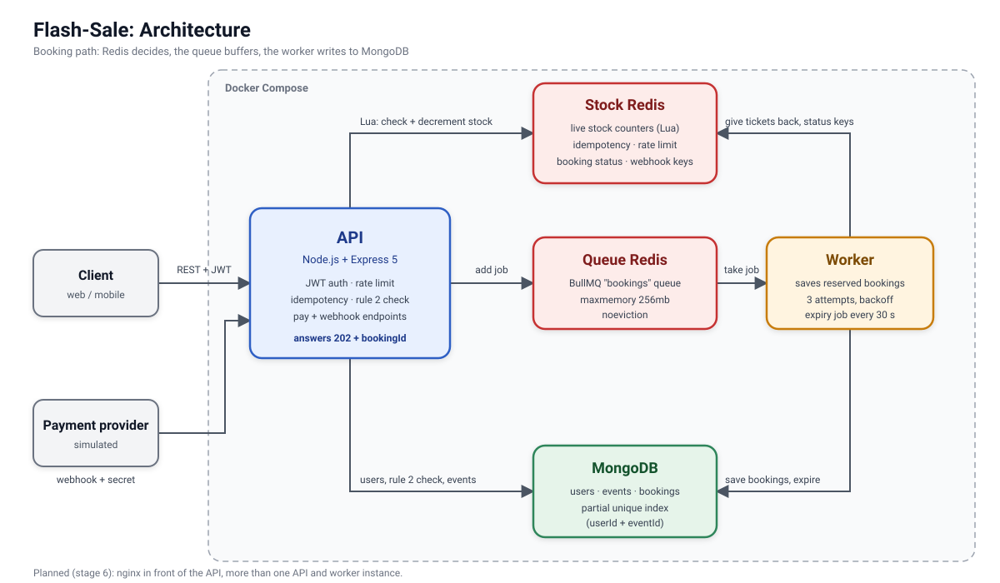
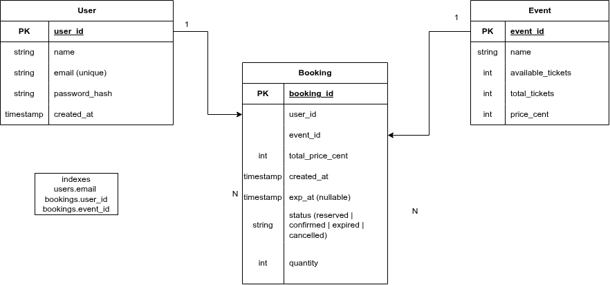

# Flash-Sale

A backend API for booking tickets to events, built to survive the moment when thousands of people hit "book" at the same time on a limited number of tickets.

> 🚧 Work in progress. I'm building this stage by stage and measuring every step.

## Why I'm building this

Selling 1,000 tickets to 10,000 people at once looks easy until two requests read "1 ticket left" at the same moment and both buy it. That's called overselling, and it's the problem this project is about.

I'm starting with a naive version on purpose, measuring how bad it gets, and then fixing it step by step with Redis, queues, and Docker. Every stage gets real numbers, so I can prove each change actually helped.

## Business Rules

1. **A booking can have 1 to 4 tickets.** Booking more than one ticket at a time forces the stock check and the decrease to happen as one atomic step, which is where the interesting problems start.
2. **A user can have one active booking per event.** Active means reserved or confirmed. This stops one person from grabbing all the stock, and it means the same request sent twice must not create two bookings.
3. **A reservation expires after 5 minutes.** If the user doesn't pay in time, the tickets go back to the available stock.
4. **Available tickets can never go below 0 or above the total.**

All four rules are enforced since stage 5.

## Architecture



The booking path in short:

1. The API checks the JWT, the rate limit and the idempotency key, then checks rule 2 in MongoDB.
2. A Lua script in Stock Redis checks and decreases the stock in one atomic step. If it is sold out, the API answers `400` right away.
3. If tickets were reserved, the API adds a job to the BullMQ queue and answers `202` with a `bookingId`.
4. The worker takes the job and saves the booking in MongoDB as `reserved`, with `expiresAt` 5 minutes ahead.
5. The user pays (`/pay` or the webhook) and the booking becomes `confirmed`. If they don't, the expiry job gives the tickets back.

## Data Model



- **User**: who is booking. Passwords are hashed with bcrypt and never returned.
- **Event**: what is being sold, with the total tickets, the available tickets, and the price.
- **Booking**: connects a user to an event, with the quantity, total price, status, and expiry time.

Booking status can be `reserved`, `confirmed`, `expired`, or `cancelled`. All prices are stored as integers in cents, never floats.

Field names in the code are camelCase (`availableTickets`, `priceCents`), while the diagram above uses snake_case.

MongoDB has a partial unique index on `userId + eventId` that only applies to `reserved` and `confirmed` bookings. It is the real guarantee for rule 2: the check in the API is a fast path, the index is what stops two simultaneous requests.

Redis keys (two separate Redis instances):

- **Stock Redis**
  - `event:<id>`: hash with `totalTickets`, `availableTickets` and `priceCents` (stage 3). The live stock counter used for booking.
  - `booking:<id>`: short-lived key (1 hour) with `processing` or `failed` (stage 4). It tells the client what happened to a booking that is not in MongoDB (yet).
  - `idempotency:booking:<userId>:<key>`: stores the `bookingId` of a booking request that carried an `Idempotency-Key` (24 hours).
  - `webhook:<paymentIntentId>`: marks a payment webhook as already processed (24 hours).
  - `ratelimit:<userId>`: request counter for rate limiting (60 seconds).
- **Queue Redis**: only BullMQ's `bookings` queue lives here. It runs with `maxmemory 256mb` and `noeviction`, so when memory is full it refuses new jobs instead of silently deleting accepted bookings.

## API

| Method | Endpoint                      | Auth    | Description                                                                                                  |
| ------ | ----------------------------- | ------- | ------------------------------------------------------------------------------------------------------------ |
| POST   | `/api/v1/auth/signup`         | no      | Create a user (`name`, `email`, `password`). Returns a JWT                                                   |
| POST   | `/api/v1/auth/login`          | no      | Log in (`email`, `password`). Returns a JWT                                                                  |
| POST   | `/api/v1/events`              | no      | Create an event (`name`, `totalTickets`, `priceCents`)                                                       |
| GET    | `/api/v1/events/:id`          | no      | Get an event; `availableTickets` is the live number from Redis                                               |
| POST   | `/api/v1/events/:id/book`     | JWT     | Book tickets (`quantity` 1 to 4). The user comes from the token. Optional `Idempotency-Key` header. Returns `202` with a `bookingId` |
| GET    | `/api/v1/bookings/:id`        | JWT     | The booking, or `processing` / `failed`, or `404`                                                            |
| POST   | `/api/v1/bookings/:id/pay`    | JWT     | Simulated payment: turns your `reserved` booking into `confirmed` (`409` if expired or not payable)          |
| POST   | `/api/v1/bookings/webhook`    | secret  | Simulated payment-provider callback. Needs the `x-webhook-secret` header                                     |

A successful booking request returns `202 Accepted`: "your request was accepted and is being processed", not "the booking is saved". Sold-out (`400`), unknown-event (`404`), already-booked (`409`) and rate-limit (`429`) answers are immediate. If the same `Idempotency-Key` is sent again, the API returns the same `202` and the same `bookingId` and takes no ticket.

All errors return a consistent JSON response (`status` and `message`).

## Tech Stack

Node.js, Express 5, MongoDB (Mongoose), Redis, BullMQ, JWT, bcrypt, Docker.

## Stages

| #   | Stage                                                                  | Status                              |
| --- | ---------------------------------------------------------------------- | ----------------------------------- |
| 1   | Naive booking + baseline numbers                                       | Done                                |
| 2   | Atomic update in MongoDB                                               | Done                                |
| 3   | Redis for stock (atomic Lua script)                                    | Done                                |
| 3b  | GET /events/:id reads Redis stock                                      | Done                                |
| 4   | BullMQ queue and worker                                                | Done                                |
| 5   | Auth, reservations, mock payment, idempotency, rate limiting           | Done                                |
| 6   | nginx, CI/CD, deploy                                                   | Not started                         |
| 7   | Tests, logging, final benchmarks                                       | Not started                         |

## Known limitations (current stage)

- If the API process dies after the stock decrement in Redis and before the job is added to the queue, those tickets are lost. The code gives the tickets back when adding the job fails, but it can't do that if the process dies. The window is small, but it is not closed.
- If the worker fails to save a booking 3 times, it gives the tickets back and marks the booking as `failed`. If that give-back itself fails, the error is only logged and the tickets are lost.
- If the worker saves a booking and dies before deleting the `booking:<id>` key, `GET /bookings/:id` keeps answering `processing` until the key's 1 hour TTL ends.
- The expiry job marks a booking `expired` and then gives the tickets back. If the process dies between the two steps, that ticket is lost.
- The 5 minutes of a reservation start when the worker saves the booking, not when the user clicked "book". If the queue is behind, the user gets a little less time.
- The expiry job runs every 30 seconds, so a reservation can stay `reserved` for up to about 30 seconds after it expired. Payment still checks `expiresAt`, so an expired reservation can't be paid.
- `GET /bookings/:id` checks ownership when the booking is in MongoDB. For the `processing` / `failed` answer (read from Redis) it does not, so anyone who has a `bookingId` can see that status, but no booking data. Booking ids are random ObjectIds.
- The payment webhook is protected by a shared secret in a header, not by a real signature (HMAC). Its idempotency key is written before the booking is updated, so if the API dies in between, a retried webhook is ignored. The update itself is atomic and safe to repeat.
- Idempotency keys are stored for 24 hours. If the API dies after storing a key and before finishing, that key answers with a `bookingId` that may never be saved, until the key expires.
- Rate limiting is a simple counter per user (20 booking requests per minute). If Redis is down the middleware fails the request. The benchmark never triggers it (`rejected429` is 0), so its cost was measured but its behavior under load was not.
- `GET /api/v1/events/:id` reads `availableTickets` from Redis. If the Redis hash is missing (for example after a Redis restart), it falls back to the number stored in MongoDB, which can be stale.
- The `availableTickets` field in MongoDB is set once when the event is created and is not updated by bookings. This is on purpose: updating it on every booking would bring back the single-document bottleneck from stage 2. The live number is in Redis, and the record of what was actually sold is the Booking collection.
- If either Redis restarts, data can be lost or roll back to an older snapshot. Persistence (AOF) is not configured yet, and there is no job that rebuilds the counters from MongoDB.
- If saving the event hash in Redis fails after the event is created in MongoDB, that event answers 404 on every booking. `POST /events` is also not protected yet.
- There is no endpoint to cancel a booking.
- There is no dashboard for failed jobs yet.

## How I measure

- The API, the worker, MongoDB and both Redis instances all run in Docker, and I keep the same setup in every stage so the numbers are comparable.
- **Measure only with the production command** (see "Running the project"). Development uses nodemon and a mounted source folder, which distorts the numbers.
- Each benchmark should start with 1 warm-up run (ignored), and then 3 measured runs. Every run uses a fresh event with 1,000 tickets.
- Each result is the average of the 3 runs, plus the range (min to max). The runs are noisy, and autocannon reports req/sec in whole seconds, so small differences between stages may just be noise.
- "Errors" counts real failures only (connection errors, timeouts, 5xx). Requests rejected because the event is sold out are counted separately.
- My first attempt was wrong: I ran the API with nodemon and a source bind mount, and a deprecation warning was printed on every request. That distorted the numbers (stage 1 showed about 308 req/s). I fixed the setup and re-measured both stages. The old raw files are kept in `results/old-nodemon/`.
- From stage 3 on, the load test reads the final stock from Redis (where the counter lives) and the bookings from MongoDB. "Stock mismatch" compares the two: 0 means the Redis counter and the MongoDB bookings agree.
- From stage 4 on, a successful request returns `202`, so the response time no longer includes the MongoDB write. The load test also waits until the worker has saved every accepted booking, and reports `drainSec`: the time from the end of the load until the last booking is in MongoDB. It is the remaining time, not the total write time, because the worker runs while the load is still going.
- From stage 5 on, every request needs a JWT and an `Idempotency-Key`, and rule 2 allows one booking per user. So the load test creates 5,000 users directly in MongoDB, signs a token for each one, and every request uses a different user. This is a different test from stages 1 to 4, so the numbers are not directly comparable.
- Before each run I checked that the queue was empty.

## Test Environment

- **Host Specs:** 8 CPU Cores, 8 GB RAM.
- **Docker Allocation:** Default Docker Desktop settings.
- **Node.js Environment:** `NODE_ENV=production` inside Docker, started with `npm start` (API) and `node worker.js` (worker).
- **Stock Redis:** `redis:7-alpine`, one container, default config.
- **Queue Redis:** `redis:7-alpine`, one container, `--maxmemory 256mb --maxmemory-policy noeviction`.
- **Queue settings:** 3 attempts per job, exponential backoff starting at 1 second. An expiry job runs every 30 seconds.
- **Load Test Tool:** `autocannon`
  - `amount`: 5,000 requests
  - `connections`: 200 concurrent connections
  - `excludeErrorStats`: false

## Results

Same test every time: 1,000 tickets, 5,000 requests sent over 200 concurrent connections, each request from a different user (`quantity: 1`).

| Stage               | Strategy                            | req/sec (avg, range)  | p99 latency (avg, range)   | Errors | Rejected (sold out) | Bookings / Tickets | Oversold |
| ------------------- | ----------------------------------- | --------------------- | -------------------------- | ------ | ------------------- | ------------------ | -------- |
| **1. Naive**        | Read-then-write (Baseline)          | 491 (417 - 556)       | 578 ms (435 - 791 ms)      | 0      | 0                   | 5,000 / 1,000      | +4,000   |
| **2. Mongo atomic** | Atomic update                       | 608 (556 - 714)       | 615 ms (394 - 745 ms)      | 0      | 4,000               | 1,000 / 1,000      | 0        |
| **3. Redis**        | Atomic Lua script in Redis          | 1,389 (1,250 - 1,667) | 427 ms (300 - 492 ms)      | 0      | 4,000               | 1,000 / 1,000      | 0        |
| **4. Queue**        | Redis + BullMQ worker               | 1,250 (1,250 - 1,250) | 238 ms (212 - 262 ms)      | 0      | 4,000               | 1,000 / 1,000      | 0        |
| **5. Full rules**   | Queue + auth, rules, idempotency, rate limit | 509 (417 - 556) | 1,227 ms (565 - 2,519 ms)  | 0      | 4,000               | 1,000 / 1,000      | 0        |

Notes on the table:

- In stages 1 to 3 a successful request meant "the booking is saved" (`201`). From stage 4 it means "accepted" (`202`), so those numbers measure the response, not the write. The write is measured separately by `drainSec`.
- Stage 4 `drainSec`: 0.010 s on average (0.008 - 0.011 s). Stage 5 `drainSec`: 0.010 s on average (0.008 - 0.012 s).
- Stage 5 is a different test (authenticated, 5,000 distinct users, idempotency key on every request), so it is not directly comparable to stages 1 to 4.
- Stage 3b only changed `GET /events/:id`, not the booking path, so it has no new benchmark.

### What I Saw in Stage 1

- **Massive overselling:** All 5,000 requests succeeded with `201 Created`, even though there were only 1,000 tickets (+4,000 oversold), in all 3 runs.
- **Lost updates (race condition):** Concurrent requests read the same `availableTickets` value and overwrote each other's updates. Instead of dropping to `0`, the final counter ended at 925 or 926 in the 3 runs. It also happens with little load: in a small test of 50 requests over 5 connections, 24 updates were lost.
- **The sold-out check never fired:** Not a single request was rejected, because the counter never got close to 0. Under concurrency, the "not enough tickets" check is useless on its own.

### What I Saw in Stage 2

- **Correctness is fixed:** In all 3 runs exactly 1,000 bookings were created, 4,000 requests were rejected as sold out, the final counter was 0, and nothing was oversold. The check and the decrement happen in one atomic MongoDB operation, so no request can sneak in between them.
- **Speed is about the same:** Average throughput was higher (608 vs 491 req/s), but the ranges almost touch and p99 latency didn't change in a meaningful way. With only 3 runs per stage, I can't claim it's faster.
- **The two stages don't do the same work:** Stage 1 saved 5,000 bookings, while stage 2 saved 1,000 and rejected 4,000 (each rejection costs two queries). My guess, which I haven't measured, is that every request competes for the same event document in MongoDB, which limits how fast it can go.
- **What's next:** Stage 3 moves the stock counter out of MongoDB and into Redis.

### What I Saw in Stage 3

- **Why Redis:** In stage 2, all 5,000 requests hit the same event document in MongoDB, including the 4,000 that were going to be rejected (each rejection cost an extra `findById`). In stage 3, the stock check and decrement run inside Redis as one Lua script, so a sold-out request is rejected in memory and never touches MongoDB. MongoDB only sees the 1,000 successful bookings.
- **Why a Lua script:** Redis runs a script as a single step, so no other request can run between the check and the decrement. That keeps the atomic guarantee from stage 2.
- **Correctness held:** In all 3 runs exactly 1,000 bookings were created, 4,000 requests were rejected, nothing was oversold, and the Redis counter matched the bookings in MongoDB (stock mismatch 0).
- **Throughput improved:** 1,389 req/s on average vs 608 in stage 2. The ranges (1,250-1,667 vs 556-714) don't overlap, so this is not just noise.
- **p99 is less clear:** 427 ms vs 615 ms, but the ranges overlap (300-492 vs 394-745), so I can't claim p99 improved.
- **Caveats:** Each run lasted only 3-4 seconds, so autocannon took just 3-4 samples per run, which makes the numbers less precise than in earlier stages. There were only 3 runs. The explanation (rejections no longer reach MongoDB) is my reasoning, not something I measured.
- **Stage 3b:** Moving the counter to Redis made `GET /events/:id` show a stale number, because MongoDB was no longer updated. It now reads `availableTickets` from Redis and keeps the rest of the event from MongoDB. If the hash is missing, it falls back to MongoDB's number.
- **What's next:** Stage 4 adds queues and workers.

### What I Saw in Stage 4

- **What changed:** After Redis reserves the tickets, the API no longer writes the booking to MongoDB itself. It generates a `bookingId`, puts a job in a BullMQ queue, and answers `202` with that id. A separate worker process takes jobs from the queue and writes the bookings to MongoDB. The client asks `GET /bookings/:id` to see the result.
- **Why a queue:**
  - **It separates the speed of accepting requests from the speed of writing to MongoDB.** The API can answer quickly while the worker writes at the pace MongoDB can handle.
  - **Failures are retried in an organized way.** A failed write is retried up to 3 times with a growing delay. Only after the last attempt does the worker give the tickets back and mark the booking as `failed`, instead of giving up at the first error.
  - **A job survives a worker crash.** It stays in Redis until a worker finishes it.
  - **A slow or unavailable MongoDB no longer makes API requests wait.** I did not measure this one.
- **Why the `bookingId` is generated in the API:** The id has to exist before the booking is saved, so the client can ask about it, and so a retried job writes the same `_id` instead of a second booking. The worker treats a duplicate key error on `_id` as success.
- **Why a separate Redis for the queue:** The queue holds accepted bookings that are not in MongoDB yet. It uses `noeviction`, so a full memory means rejected jobs, not deleted ones. Keeping it apart means a growing queue cannot fill the memory used by the stock counters.
- **Correctness held:** In all 3 runs exactly 1,000 requests were accepted, 4,000 were rejected, 1,000 bookings ended up in MongoDB, nothing was oversold, and the stock mismatch was 0.
- **Failure path checked by hand:** I stopped MongoDB, made a booking, and watched the worker retry and give the tickets back at the end. This was a manual check, not an automated test.
- **Throughput: no claim.** 1,250 req/s vs 1,389 in stage 3. The ranges overlap, and every stage 4 run reported exactly 1,250 because autocannon counts whole seconds over a 4-second run. This is noise, not a result.
- **p99: a tendency, not a result.** 238 ms vs 427 ms. All 3 runs were below the stage 3 average, but the ranges overlap (212-262 vs 300-492), so with 3 runs I can't claim it improved.
- **`drainSec` was about 10 ms:** The worker kept up with the load, so almost every booking was already in MongoDB when the load ended. This is the time left after the load, not the total time to write.
- **The work is the same as in stage 3:** MongoDB still receives the same 1,000 writes, and the 4,000 rejections still never reach it. The queue does not reduce MongoDB's work; it moves it out of the request.
- **Caveats:** Runs lasted about 4 seconds (4 samples), there were only 3 runs, and a `202` does not mean the booking is saved, so stage 4 is not directly comparable to stage 3. The reasons above are my reasoning, and only the correctness numbers were measured.

### What I Saw in Stage 5

- **What changed:**
  - **Users and login:** signup and login return a JWT, and a `protect` middleware reads it. The booking endpoint takes the user from the token, so nobody can book in someone else's name.
  - **Rule 2:** the API first checks MongoDB for an existing booking (`409`). The partial unique index is the real guarantee, because two simultaneous requests can both pass the check. If the index rejects a booking in the worker, the worker gives the ticket back and marks the booking `failed`. It tells this case apart from a retried job by looking at which key was duplicated (`_id` means "already saved", anything else means "duplicate user + event").
  - **Reservations (rule 3):** the worker saves bookings as `reserved` with `expiresAt` 5 minutes ahead. A job that runs every 30 seconds marks expired reservations as `expired` and gives their tickets back to Redis. Marking is one atomic update that only matches `reserved`, so one booking can't be expired twice.
  - **Mock payment:** `POST /bookings/:id/pay` turns the user's own `reserved` booking into `confirmed`, in one atomic update that also checks the reservation did not expire. If payment and expiry happen at the same moment, only one of them wins.
  - **Webhook:** the same confirmation can come from a payment-provider callback. A shared secret protects it, and a Redis key per `paymentIntentId` makes a repeated webhook do nothing.
  - **Idempotency for booking requests:** with an `Idempotency-Key` header, a repeated request returns the same `bookingId` and takes no ticket. This helps a client whose connection dropped before it saw the first answer.
  - **Rate limiting:** a Redis counter per user, 20 booking requests per minute.
- **Correctness held:** In all 3 runs exactly 1,000 requests were accepted, 4,000 were rejected as sold out, 1,000 bookings ended up in MongoDB, nothing was oversold, and the stock mismatch was 0.
- **It got slower, and I expected that:** 509 req/s vs 1,250 in stage 4, and p99 1,227 ms vs 238 ms. Every request now does much more: verify the JWT, load the user from MongoDB, run the rule-2 query in MongoDB, run the rate limit and idempotency commands in Redis. This is my explanation, I did not measure which of these costs the most. Stage 4 was fast because it had none of these protections.
- **Not the same test:** stage 5 uses 5,000 distinct authenticated users and an idempotency key on every request. The 4,000 sold-out requests now also pay for the rule-2 query before Redis rejects them, which brings back a part of the MongoDB work stage 3 had removed.
- **Caveats:**
  - The first run was cold (p99 2,519 ms; runs 2 and 3 were 596 and 565 ms), and I did not do a separate warm-up run for this stage, so the average p99 is pulled up by it.
  - Runs lasted 9 to 12 seconds, so there were more samples than in stages 3 and 4.
  - There were only 3 runs.
  - No request was rejected by rule 2 or by the rate limit (`rejected409` and `rejected429` were 0), because each user booked once. The benchmark measures what these checks cost, not how they behave under pressure.
  - The payment flow, the expiry job and the idempotent retry were checked by hand, not by automated tests.
  - `drainSec` was again about 10 ms, so the worker kept up.
- **What's next:** Stage 6 adds nginx, more than one API and worker instance, CI/CD and a deploy to a VPS. Stage 7 adds automated tests (the overselling test first), structured logging and the final benchmarks.

## Running the project

Environment variables (in `config.env` for running outside Docker, and in `docker-compose.yml` for Docker): `DATABASE_LOCAL`, `REDIS_URL`, `QUEUE_REDIS_URL`, `JWT_SECRET`, `JWT_EXPIRES_IN`, `WEBHOOK_SECRET`, and optionally `IDEMPOTENCY_KEY_EXPIRE_SECONDS`. `config.env` is not committed.

**Development** (nodemon, code mounted into the containers, no rebuild after edits):

```bash
docker compose -f docker-compose.yml -f docker-compose.dev.yml up -d
```

**Benchmark** (production mode, no nodemon, no mounted code). Stop the development containers first:

```bash
docker compose down
NODE_ENV=production docker compose up -d --build --force-recreate
npm install
node scripts/loadtest.js my-run-label
```

The API runs on `http://localhost:3000`. This starts the API, the worker, MongoDB and both Redis instances.